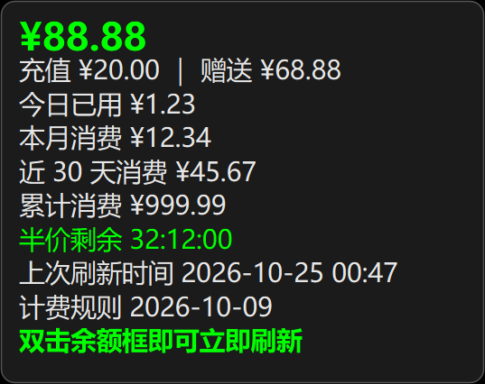

# 桌面余额牌（balance-chip）

<p align="center">
  
  
</p>

> 图中金额为示意数据，非真实账户。

一个 Windows 桌面小挂件：常驻显示 DeepSeek 账户余额，与 DSH 客户端同开同关。
单文件 Python + PySide6 实现，不占任务栏、不抢焦点、不弹窗、无形象。

---

## 目录

- [这是什么](#这是什么)
- [特性](#特性)
- [颜色到底什么意思](#颜色到底什么意思)
- [详情面板：每一行是什么](#详情面板每一行是什么)
- [安装](#安装)
- [运行](#运行)
- [使用](#使用)
- [配置项](#配置项)
- [状态文件在哪](#状态文件在哪)
- [怎么确认它在正常跑](#怎么确认它在正常跑)
- [停止与卸载](#停止与卸载)
- [常见问题](#常见问题)
- [数据来源](#数据来源)
- [已知限制](#已知限制)
- [开发者说明](#开发者说明)
- [版本](#版本)
- [致谢与来源](#致谢与来源)
- [免责声明](#免责声明)
- [许可](#许可)
- [English](#english)

---

## 这是什么

一个**贴在屏幕角落的小牌子**，显示 DeepSeek 账户还剩多少钱。

它解决的具体问题是：你在 DSH（DeepSeek Harness）里连续干活时，不想每次都切到浏览器去查余额；
也不想等扣光了才发现。所以它把"余额"和"当前计费时段"压缩成一眼能扫完的两个信号：

- **数字**：还剩多少钱；
- **外框颜色**：现在是半价、还是高峰、还是快换时段了。

默认放在屏幕右下角，可以拖到任何地方；关掉 DSH 它会自己退出；不想要了可以随时关。

---

## 特性

| 特性 | 说明 |
|---|---|
| 收起态 | 一个圆角小牌，只显示 `¥xx.xx`；高度 40 逻辑像素 |
| 时段提示 | 外框颜色 = 当前计费时段（半价 / 高峰 / 半价将尽 / 未知） |
| 余额提示 | 数字颜色 = 余额档位（低 / 告急 / 正常） |
| 详情面板 | 单击展开：余额构成、今日/本月/近 30 天/累计消费、倒计时、刷新时间、计费规则日期 |
| 立即刷新 | 双击（或右键菜单、托盘菜单）随时刷新，不用等自动刷新 |
| 自动刷新 | 默认每 5 分钟一次，可在配置里改 |
| 跟随拖动 | 面板打开时拖动牌子，面板跟着一起走，不会被牌子挡住 |
| 记住位置 | 拖动后位置写进配置，下次启动回到原处 |
| 不打扰 | 不占任务栏、不抢焦点、不做动画、没有声音、没有形象 |
| 单实例 | 重复启动不会开出第二个，已有实例会被激活/忽略 |
| 随 DSH 启停 | 由 DSH 插件拉起，心跳停了就自己退出（见下文） |
| 浅色/深色 | 跟随 Windows 应用主题（可强制指定） |

---

## 颜色到底什么意思

颜色有两套，别混了：**外框管时段，数字管余额**。

### 外框（= 当前计费时段）

| 颜色 | 含义 | 什么时候出现 |
|---|---|---|
| 绿 `#00FF00` | 半价时段 | 工作日 09:00–12:00、14:00–18:00 之外；以及周末全天 |
| 红 `#FF0000` | 高峰时段（全价） | 工作日 09:00–12:00、14:00–18:00 |
| 黄 `#FFFF00` | 半价即将结束 | 半价剩余不足 1 小时（`HALF_WARN_SEC = 3600`） |
| 灰 `#AAAAAA` | 未知 | 取数中、或时段判断失败 |

时间一律按**北京时间（UTC+8）**算，与平台计费口径一致。

### 数字（= 余额档位）

| 颜色 | 含义 | 默认阈值 |
|---|---|---|
| 红 `#FF0000` | 告急 | 余额 < ¥5 |
| 黄 `#FFFF00` | 偏低 | 余额 < ¥20 |
| 绿 `#00FF00` | 正常 | 余额 ≥ ¥20 |
| 灰 `#AAAAAA` | 未知 | 取数中 / 取不到 |

阈值可在配置里改（`low` / `critical`），见[配置项](#配置项)。

---

## 详情面板：每一行是什么

单击牌子展开，面板默认在牌子上方（空间不够时自动翻到下方，且不会压住牌子）。
面板打开后 60 秒自动收起；再单击牌子立即关闭。

| 行 | 含义 | 数据来源 |
|---|---|---|
| `¥88.88` | 账户可用总余额 | 平台余额接口 |
| `充值 ¥20.00 ｜ 赠送 ¥68.88` | 余额构成：自己充的 / 平台赠送的 | 平台余额接口 |
| `今日已用 ¥1.23` | 北京时间今天 0 点起的消费 | 平台按天用量接口 |
| `本月消费 ¥12.34` | 本自然月累计 | 平台按天用量接口 |
| `近 30 天消费 ¥45.67` | 最近 30 天（含今天）累计 | 平台按天用量接口 |
| `累计消费 ¥999.99` | 账户历史累计消费 | 平台余额接口的累计字段 |
| `半价剩余 32:12:00` | 距下一个时段切换还有多久（小时累计到秒，不进位成"天"） | 本地按时段规则计算 |
| `上次刷新时间 2026-10-25 00:47` | 最近一次成功取数的时间（本地时间） | 本地记录 |
| `计费规则 2026-10-09` | 最后一次核对官方定价页的日期；超过 30 天该行变黄并提示复核 | 程序中写死的日期常量 |
| `双击余额框即可立即刷新` | 提示行 | 固定文案 |

**关于"今日已用"与余额的差值**：余额里包含充值、赠送、退款等非消费变动，所以"余额变化"不等于"消费"。
本程序优先用平台按天费用接口，只有在那个接口取不到时才退回本机记账（按余额差值估算，见[已知限制](#已知限制)）。

---

## 安装

### 情况 A：你机器上已经有 DSH（推荐）

本程序本来就是配合 DSH 用的：DSH 启动时由插件拉起，DSH 退出时它自己退出。
把仓库克隆下来，装好依赖，放在一个**以后不会移动或删除**的固定目录里即可：

```powershell
git clone https://github.com/YYXXMMCN/balance-chip.git
cd balance-chip
python -m venv .venv
.venv\Scripts\python -m pip install -r requirements.txt -i https://pypi.tuna.tsinghua.edu.cn/simple
```

然后双击 `run.cmd`（无控制台窗口启动）。

> 注意：`python` 必须是 **64 位 3.12 及以上**。用 `python -c "import struct;print(struct.calcsize('P')*8)"` 可确认位数，输出 `64` 才对。

### 情况 B：机器上没有 Python

1. 去 <https://www.python.org/downloads/windows/> 下载 **Windows installer (64-bit)**，装的时候勾选 **Add python.exe to PATH**；
2. 重开一个终端，执行 `python --version` 能看到版本号；
3. 再按情况 A 的第 2–4 步做。

> 如果你只是想要个"能用"的挂件、不想折腾 Python，那这个项目目前**没有**打包好的安装包或 Releases
> —— 它是一份可读可改的源码，不是成品软件。

### 依赖装不上 / 很慢

国内网络下先换镜像（上面已用清华源）。若仍失败：

```powershell
.venv\Scripts\python -m pip install --upgrade pip -i https://pypi.tuna.tsinghua.edu.cn/simple
.venv\Scripts\python -m pip install PySide6-Essentials requests -i https://pypi.tuna.tsinghua.edu.cn/simple
```

依赖只有两个：`PySide6-Essentials`（界面）和 `requests`（取数）。

---

## 运行

```powershell
# 带控制台窗口（能看到错误信息，第一次建议这样跑）
.venv\Scripts\python balance_chip.py

# 不带控制台窗口（日常用）
.venv\Scripts\pythonw balance_chip.py

# 由 DSH 插件调用：加心跳检查，心跳过期即自动退出
.venv\Scripts\pythonw balance_chip.py --follow-dsh
```

参数只有一个：

| 参数 | 作用 |
|---|---|
| `--follow-dsh` | 启用心跳检查：每 3 秒读一次心跳文件，超过 15 秒没更新就退出（防止 DSH 被强杀后挂件残留在桌面上） |

`run.cmd` 等价于用 `pythonw` 启动主程序，不加参数。

---

## 使用

| 操作 | 效果 |
|---|---|
| **左键单击** | 展开 / 收起详情面板 |
| **左键双击** | 立即刷新；**刷新完成那一帧**面板同时出现（数字变了，面板就到，不会晚一步） |
| **按住拖动** | 移动牌子；面板打开时一起移动；松手后记住位置 |
| **右键单击牌子** | 菜单：立即刷新 / 详细信息 / 退出 |
| **托盘图标右键** | 同一套菜单；托盘提示文字是「桌面余额牌」 |

说明：

- 双击判定用**系统双击间隔**（控制面板里的那个设置），慢一点的双击也能识别；
- 拖动过程中不会触发点击，不会"拖完顺手点开面板"；
- 面板打开时单击牌子是关闭，不是刷新；刷新用双击或菜单。

---

## 配置项

配置文件位置：

```
%LOCALAPPDATA%\CiviWineHouse\balance-chip\config.json
```

**第一次运行后才会生成**（没有就按默认值跑）。字段：

| 字段 | 默认 | 说明 |
|---|---|---|
| `low` | `20.0` | 余额低于此值，数字变黄 |
| `critical` | `5.0` | 余额低于此值，数字变红 |
| `refreshSec` | `300` | 自动刷新间隔（秒），最小 30 |
| `theme` | `"auto"` | `auto` 跟随系统 / `light` 强制浅色 / `dark` 强制深色 |
| `pos` | `null` | 牌子位置 `{"x":123,"y":456}`，拖动时自动写入；删掉这段就回到右下角默认位置 |

改法（改完要**退出程序再启动**才生效）：

```powershell
notepad "$env:LOCALAPPDATA\CiviWineHouse\balance-chip\config.json"
```

示例：

```json
{
  "low": 30.0,
  "critical": 10.0,
  "refreshSec": 120,
  "theme": "dark",
  "pos": {"x": 2433, "y": 1166}
}
```

常见改法：

- 觉得 5 分钟刷新太慢：`refreshSec` 改 `60`（别改太小，平台接口有限流）；
- 想提前收到"余额偏低"提示：把 `low` 调高（比如 30）；
- 深色桌面上浅色牌子更显眼：`theme` 改 `light`。

---

## 状态文件在哪

都在 `%LOCALAPPDATA%\CiviWineHouse\balance-chip\` 下：

| 文件 | 用途 | 能不能删 |
|---|---|---|
| `config.json` | 上面的配置 + 牌子位置 | 能删，删了恢复默认（位置回到右下角） |
| `usage.json` | 本机记账（按天留存最近 60 天），只在平台用量接口取不到时用来兜底 | 能删，删了只是本机记账历史没了 |
| `dsh-alive.txt` | DSH 插件写的**心跳文件**（每 5 秒更新一次时间戳） | 别手动删（删了带 `--follow-dsh` 的实例会在 15 秒内退出） |
| `*.lock` | 单实例锁 | 程序异常退出后如果起不来，可删（确认没有实例在跑） |

凭据不在这里：它读的是 DSH 自己的凭据文件 `~\.dsh\.credentials.yaml`，**只读、不复制、不写回**。

---

## 怎么确认它在正常跑

三条，按顺序：

1. **看屏幕右下角**（或你拖到的位置）有没有那块小牌；
2. **看托盘**有没有「桌面余额牌」图标，右键能不能出菜单；
3. **看心跳与进程**（DSH 场景）：

```powershell
# 进程在不在
Get-Process pythonw -ErrorAction SilentlyContinue | Select-Object Id, StartTime

# 心跳文件多久没更新（正常应 < 15 秒）
$hb = "$env:LOCALAPPDATA\CiviWineHouse\balance-chip\dsh-alive.txt"
if (Test-Path $hb) { [math]::Round((Get-Date) - (Get-Item $hb).LastWriteTime, 1) } else { "心跳文件不存在" }
```

双击牌子看「上次刷新时间」是不是刚刚，也是最快的自检方式。

---

## 停止与卸载

**只是不想看了**：右键牌子（或托盘图标）→ 退出。

**彻底卸载**：

```powershell
# 1) 先退出程序（任务栏托盘右键退出，或）
Get-Process pythonw -ErrorAction SilentlyContinue | Where-Object { $_.Path -like "*balance-chip*" } | Stop-Process -Force

# 2) 删掉程序目录（你自己克隆的那个文件夹）
# 3) 删掉配置与状态目录
Remove-Item "$env:LOCALAPPDATA\CiviWineHouse\balance-chip" -Recurse -Force
```

如果你是通过 DSH 插件挂上的，还要在 DSH 的插件管理里把这个插件停用/卸载，否则 DSH 下次启动还会把它拉起来。

---

## 常见问题

**Q1. 双击没反应，面板不出现？**
两次点击要落在**系统双击间隔**内（默认 500 毫秒）。太快连点有时会被系统合并成单击；太慢会被当成两次单击（第一次开/关面板，第二次又关掉）。
如果确定是双击：看牌子上数字是否变成 `¥…`；没变说明点击没落到牌子上（可能被别的置顶窗口挡住了）。

**Q2. 数字一直显示 `¥…`？**
说明正在取数。每次刷新要请求两次平台接口（余额 + 当月/上月用量），网络慢时可能 1–3 秒。
如果一直不变：检查网络/代理；看是否被平台限流（见 Q4）；双击刷新一次试试。

**Q3. 数值不动 / 好像卡住了？**
余额没消费时数字本来就不会变。判断是否在刷新看「上次刷新时间」。
自动刷新默认 5 分钟一次；嫌慢改 `refreshSec`。

**Q4. 报错 HTTP 429？**
平台限流。等几分钟再试，别连续双击刷新。`refreshSec` 不要设得比 60 秒更小。

**Q5. 提示"取不到余额"？**
多半是 DSH 没登录（或凭据文件里没有对应条目）。先在 DSH 里正常登录一次；
确认 `%USERPROFILE%\.dsh\.credentials.yaml` 存在且含 `deepseek-account-platform` 的 token 段。
程序只读这个文件，不会改它。

**Q6. 面板位置怪 / 牌子跑到屏幕外？**
位置按逻辑像素保存。换过分辨率、缩放比例或多显示器后，程序会把位置**夹回当前屏幕内**（不会消失）。
如果还是不对：删掉配置里的 `pos` 字段，回默认右下角。

**Q7. 启动后自己退出了？**
大概率是加了 `--follow-dsh` 但心跳文件不存在/过期（DSH 已经关了）。这是设计行为。
日常手动用不要带这个参数。

**Q8. 150% 缩放下字发虚 / 位置有偏差？**
Qt 高 DPI 缩放会自动处理，但外框细线（2px）在高分屏上可能看起来偏细；这是正常现象，不是渲染错误。

**Q9. 能用命令行看余额吗？**
可以，但不属于本程序：仓库里只有桌面挂件。取数逻辑就两个 GET 请求，见[数据来源](#数据来源)。

**Q10. 换电脑后"累计消费"和"近 30 天"对得上吗？**
「累计消费」「本月/近 30 天」来自平台账户数据，换机器也一致；
只有"本机记账"兜底数据是本机的，换机器就没了（它本来只是兜底）。

---

## 数据来源

全部来自 DeepSeek 开放平台（`platform.deepseek.com`），用的是 DSH 已登录账号的凭据，**不需要单独申请 API Key**。

| 数据 | 接口（私有网页接口） |
|---|---|
| 余额（合计/充值/赠送）、累计消费 | `GET /api/v0/users/get_user_summary` |
| 按天消费（今日 / 本月 / 近 30 天） | `GET /api/v0/usage/cost?month=M&year=Y` |

取数细节：

- 请求头需要带浏览器 User-Agent（默认的 python-requests UA 会被拒绝）；
- 凭据从 `~\.dsh\.credentials.yaml` 里读取，只在内存中使用，**不落盘、不进日志**；
- "近 30 天"会跨月，所以会请求**当月 + 上月**两份用量数据再合并；
- 用量里 `REQUEST` 类型是"请求条数"，不是钱，求和时排除。

> ⚠️ `usage/*` 是**平台网页自己在用的私有接口**，官方没有公开文档，字段和行为随时可能变。
> 一旦它失效，面板会退回"本机记账"口径（按余额差值估算今日消费），并照常显示，不会崩溃。

---

## 已知限制

1. **只支持 Windows**（用了 Win32 桌面特性与 Windows 主题读取）；
2. **依赖私有接口**，平台改版就可能失效，见上；
3. **没有安装包**：需要自己装 Python 跑源码；
4. **本机记账只是兜底**：它按"余额差值"估算，跨机器、跨设备不同步，且会忽略单次超过 ¥20 的骤降（可能是退款/赠送变动，不能当消费）；
5. **品牌色是纯色**（绿/红/黄），不做渐变、不做主题皮肤；
6. **只显示一个账户**（DSH 当前登录的那个）。

---

## 开发者说明

单文件：`balance_chip.py`（约 790 行）。大致分五块：

```
常量与配置     路径、颜色、字号、阈值、峰谷时段
平台取数       query_wallet() / query_usage_cost()
记账兜底       update_usage() / recent_sum()
峰谷与格式化   pricing_state() / fmt_hms() / fmt_money()
界面           ChipWindow（收起态）、PanelWindow（面板）、App（调度）
```

想改动的话，改这几个常量最省事（都在文件开头附近）：

| 想改什么 | 改哪里 |
|---|---|
| 牌子字号 / 高度 / 圆角 | `CHIP_FONT` / `CHIP_H` / `CHIP_RADIUS` |
| 面板宽度 / 行高 / 字号 | `PANEL_W` / `PANEL_ROW_H` / `PANEL_FONT` |
| 三档文字颜色 | `STATE_COLOR` |
| 深色/浅色配色 | `DARK` / `LIGHT` |
| 峰谷时段 | `PEAK_WINDOWS = [(9, 12), (14, 18)]` |
| 半价将尽提醒阈值 | `HALF_WARN_SEC` |
| 计费规则日期 | `RULE_UPDATED` / `RULE_STALE_DAYS` |

**给面板加一行**：在 `App.update_panel()` 里给 `rows` 追加 `(文本, 类型, 颜色)` 三元组即可；
类型 `big` 是大号标题行，`sub` 是普通行，`button` 是绿色提示行。面板高度会自动按行数算。

**调试**：用 `python balance_chip.py` 启动（不要 `pythonw`），异常会打在控制台；
取数部分是独立线程，界面不会卡。

**样式约束**（有意为之，不是没做）：

- 不做动画/走路/形象 → 这是"工作用读数"，不是桌宠；
- 面板不做滚动、不做多级菜单 → 一屏看完；
- 不写注册表、不设开机自启 → 只由 DSH 插件拉起。

---

## 版本

**0.1.0**（2026-10-25 首次公开）

时间线（同一天内完成）：

| 轮次 | 做了什么 |
|---|---|
| 1 | 自研桌面挂件替换掉外包的网页悬浮层：无边框置顶窗、拖动记忆、峰谷颜色、双击刷新 |
| 2 | 消费数据改用平台按天用量接口（今日/本月/近 30 天/累计全是真实值） |
| 3 | 修双击判定（系统双击间隔）、面板与数字同帧出现、面板定位不压牌、底部留白 |
| 4 | 公开仓库：示意图（演示金额）、英文摘要、免责声明、清掉真实金额 |

> 版本号目前很随意（0.1.0 起），因为还没有发布流程；改代码不需要改版本号。

---

## 致谢与来源

- 交互思路参考了开源社区桌面挂件的公开经验，例如
  [大肥鱼桌宠](https://github.com/RYANFFY/deepseek-dafeiyu-pet)（MIT）与
  [DSH 小鲸鱼记账挂件](https://github.com/MeteorNOX/DeepSeek-Balance-Whale-Widget)（MIT）：
  置顶透明窗、拖动、不抢焦点、随客户端启停、以及"余额差值记账"这套思路。
- 本仓库代码为独立实现（PySide6 重写），未复制上述项目的代码，也未使用其二次元素材。
- 平台 `usage/*` 接口的线索来自 [dsh-deepseek-usage](https://github.com/AzureHalcyon/dsh-deepseek-usage) 的文档。

## ⚠️ 这不是桌宠（开玩笑的）

没有二次元形象、不会走动、不会出声、不会跟你互动。
它就是工作的时候瞄一眼余额的小牌 —— 仅此而已。

你要是冲着"可爱"来的，这里真没有，别怪我没提醒你 :)

## 免责声明

本项目（含全部代码、文档与截图）**100% 由 AI 生成**，未经专业软件工程评审。

- 代码可能存在 bug、逻辑缺陷、上游接口变更导致的失效，以及未覆盖的边界情况；
- 使用、复制、修改或分发本项目的人，应当具备**独立识别与评估代码缺陷的能力**，并自行承担使用后果；
- 作者不对因使用本项目产生的任何直接或间接损失、数据损失、账号风险或第三方纠纷承担责任；
- 涉及 DeepSeek 平台接口的部分依赖**未公开的私有接口**，其可用性、稳定性与合规风险由使用者自行判断并承担；
- 本项目与 DeepSeek 官方无关，未获其授权或背书；参考过的第三方思路已在「致谢与来源」中署名。

**如果你不具备判断"这段代码是否安全可用"的能力，请不要在真实账户或生产环境中运行它。**

## 许可

MIT（本仓库代码）。平台接口为私有接口，使用者自担风险。

---

## English

A tiny always-on-top Windows widget that shows your DeepSeek account balance. Single file, PySide6, MIT.

> Note: this English section is a brief summary; **the full documentation is in Chinese**.

- **Collapsed chip**: `¥xx.xx`. Border colour = billing period (green = off-peak half price,
  red = peak, yellow = half price ending within 1 h). Text colour = balance level
  (red < ¥5, yellow < ¥20, green otherwise).
- **Click**: detail panel — balance breakdown, today / this month / last 30 days / total spend,
  off-peak countdown (hours:minutes:seconds), last refresh time, and the date the pricing rules
  were last verified. The panel hides after 60 s.
- **Double-click**: refresh now — the panel appears in the same frame as the new number.
- **Drag**: move the chip; the open panel follows. Position is remembered.
- **Right-click**: menu (refresh / details / quit). Tray icon provides the same menu.
- Auto refresh every 5 minutes (`refreshSec` in config), no taskbar entry, never steals focus,
  no animation, no sound, no sprite.
- Start/stop with the DSH client: the host plugin writes a heartbeat file every 5 s; with
  `--follow-dsh` the widget checks it every 3 s and exits when it is older than 15 s.
- Config: `%LOCALAPPDATA%\CiviWineHouse\balance-chip\config.json`
  (`low`, `critical`, `refreshSec`, `theme`, `pos`).
- Data: reads the local DSH credential file (`~/.dsh/.credentials.yaml`, read-only) and calls
  DeepSeek platform endpoints — `users/get_user_summary` for balance and `usage/cost` for
  per-day spend. No API key needed if DSH is signed in.

> `usage/*` are private web endpoints of the DeepSeek platform, undocumented and subject to change.
> If they fail, the panel falls back to local balance-difference accounting.
> Not affiliated with DeepSeek. Screenshots use demo amounts.
> Windows only. There is no packaged installer or release — this is source code.

## ⚠️ Not a desktop pet (jokingly)

No anime character, no walking, no sounds, no interaction.
It is just a small meter you glance at while working — that's all.

If you came here looking for something cute: there is none, don't say I didn't warn you :)

## Disclaimer

This project (code, documentation and screenshots included) was **generated 100% by AI**
and has not been through a professional software-engineering review.

- The code may contain bugs, logic flaws, breakage caused by upstream API changes, and unhandled edge cases.
- Anyone who uses, copies, modifies or redistributes this project should be **capable of identifying
  and assessing defects independently**, and bears the consequences of doing so.
- The author accepts no liability for any direct or indirect loss, data loss, account risk or
  third-party dispute arising from the use of this project.
- Parts that call DeepSeek platform endpoints rely on **undocumented private endpoints**; their
  availability, stability and compliance are the user's own judgement and responsibility.
- This project is not affiliated with, authorised by, or endorsed by DeepSeek.
  Ideas borrowed from third-party projects are credited under "Acknowledgements".

**If you cannot judge whether this code is safe and usable, please do not run it in production
or against a real account.**

## License

MIT
